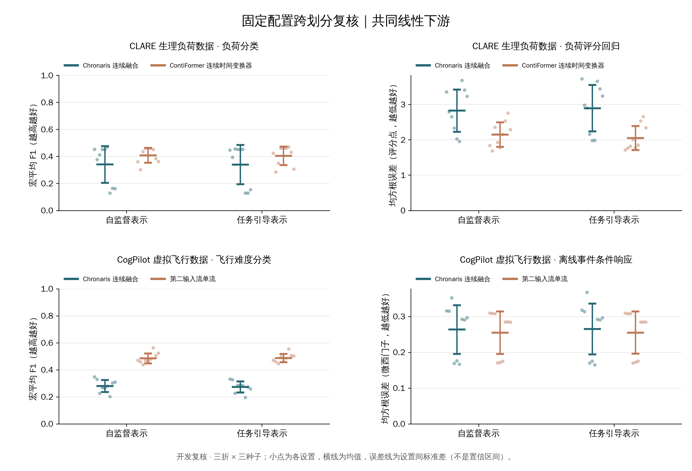
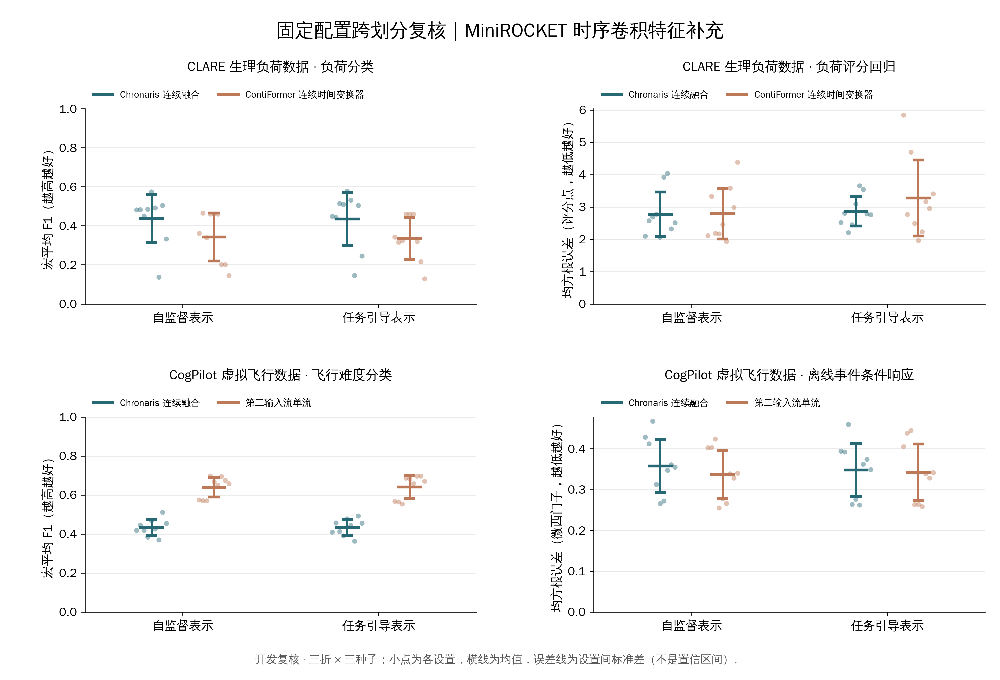

# 阶段 5 固定参考复核收口

**36 个模型单元、72 条表示路线已全部完成，结果支持进入正式训练与主模型冻结。** 总控 `1820467` 于 2026 年 9 月 28 日 09:52 正常结束，恢复队列墙钟约 37.40 小时，失败列表为空。12 个旧单元完成重验证，24 个单元完成接续，其中一个保留既有预训练；本次新增 12,900 次训练更新。原四个阶段 4 继承单元包含在 12 个重验证单元中，不重复相加。

本批是固定公开开发划分上的三折三种子复核，包含主线性下游和 MiniROCKET 时序卷积特征补充；独立外层评价尚未打开。原阶段 4.5 各轮不利结果保持不变，本次完成条件是范围完整、公平和可复现。

## 任务表现

**线性主下游的平均结果未形成融合优势，时序补充在 CLARE 分类上保留了收益。** 下表按三折、三种子九个设置等权汇总，每格为“Chronaris 连续融合／预定参照”。CLARE 生理负荷数据的参照是 ContiFormer 连续时间变换器；CogPilot 虚拟飞行数据的参照是第二输入流单流。分类使用宏平均 F1，越高越好；回归使用均方根误差，越低越好。不同数据域回归单位不同，不合并为总分。

| 下游 | 数据与路线 | 分类 F1 ↑ | 回归误差 ↓ |
| --- | --- | ---: | ---: |
| 共同线性 | CLARE，自监督 | 0.3402 / 0.4080 | 2.8217 / 2.1425 |
| 共同线性 | CLARE，任务引导 | 0.3396 / 0.4046 | 2.8921 / 2.0472 |
| 共同线性 | CogPilot，自监督 | 0.2808 / 0.4852 | 0.2634 / 0.2548 |
| 共同线性 | CogPilot，任务引导 | 0.2739 / 0.4873 | 0.2650 / 0.2548 |
| 时序补充 | CLARE，自监督 | 0.4374 / 0.3434 | 2.7727 / 2.7889 |
| 时序补充 | CLARE，任务引导 | 0.4353 / 0.3360 | 2.8630 / 3.2748 |
| 时序补充 | CogPilot，自监督 | 0.4324 / 0.6395 | 0.3578 / 0.3371 |
| 时序补充 | CogPilot，任务引导 | 0.4331 / 0.6414 | 0.3480 / 0.3424 |

**原首折 CLARE 分类收益没有在完整线性复核中保持。** 任务引导线性分类平均 F1 为 0.3396，低于参照 0.4046；回归误差为 2.8921，高于参照 2.0472。时序补充的分类均值则为 0.4353，高于参照 0.3360，回归误差为 2.8630，低于参照 3.2748。结果表明收益依赖下游读取方式；这两张表本身不能确定造成差异的具体模型机制。

**CogPilot 的强单流优势在两种下游中都保持。** 任务引导线性分类差约 −0.2134，时序补充分类差约 −0.2083；相应回归均值也均落后。完整设置与受试者数据全部保留，后续正式训练不因这些不利结果追加候选或更换参照。

下图展示主线性下游的九个设置与均值，支撑跨划分波动和参照差距的判断。误差线为设置间标准差，不是置信区间。

下图展示真实序列补充下游的对应结果，支撑 CLARE 局部收益与 CogPilot 持续不足的判断。它与主线性结果分别报告，不能用补充表替换原主评价。

CLARE 回归目标是原始 10 秒区间的负荷评分，误差单位为评分点；CogPilot 回归目标是事件后 8 秒与前 2 秒的皮肤电导中位数之差，误差单位为微西门子（µS）。本批两个回归任务各有一个字段，均未对目标误差再做标准化：先算每位受试者的均方根误差，再对受试者等权平均，最后对九个划分与种子设置等权平均。因此 2.8921 表示评分点误差，0.2650 表示微西门子误差，而非百分比。

## 成本、来源与交付

**来源与派生数据已核验，绘图可以脱离仓库算法独立进行。** 本包校验 49 份完成收据，绑定全部单元、原始来源及下游文件；导出 288 条设置指标、528 条分组指标和 32 条汇总，72 条训练记录合计新增 12,900 次更新。[证据清单](evidence.json)记录来源散列，[便携检查](verify.py)仅使用标准库检查原始绘图输入与汇总关系。

成本表保留每个单元的实际秒数与继承类别。12 个单元本轮只重算消费者，失败单元继承了 300 次预训练；这些成本不能与新完整训练单元直接平均。原训练成本保留在历史来源，不将恢复墙钟重复计为新训练成本。

**所有绘图依赖都在本目录内，由 Git 跟踪。** 数据、样式和脚本的对应关系、手工修订方法及最小依赖见[独立绘图说明](README.md)。`plot.py` 不导入算法模块、不访问模型或数据库、不重算指标；PNG 与可编辑 SVG 同时交付。已将目录复制到仓库外，以 Python 隔离模式重绘，两张 PNG 逐字节一致，见[重绘验证](render_validation.json)。两张关键 PNG 已目视检查中文字体、图例与点位，修正了图例遮挡。

## 正式训练接续

**下一批固定完整方法训练矩阵，再完成主模型冻结。** 按[正式训练协议](../../../requirements/thesis-stage5-formal-training-20260928.md)，覆盖 279 个模型单元、477 条表示路线；沿用当前固定参考与既有近期模型适配预算，显式绑定划分、种子及数据角色，训练与内部验证不开放外层观测。完整正式主表、核心机制模型、消融与压力仍须在相应冻结条件满足后接续，不能将本批开发收口写成正式确认完成。
