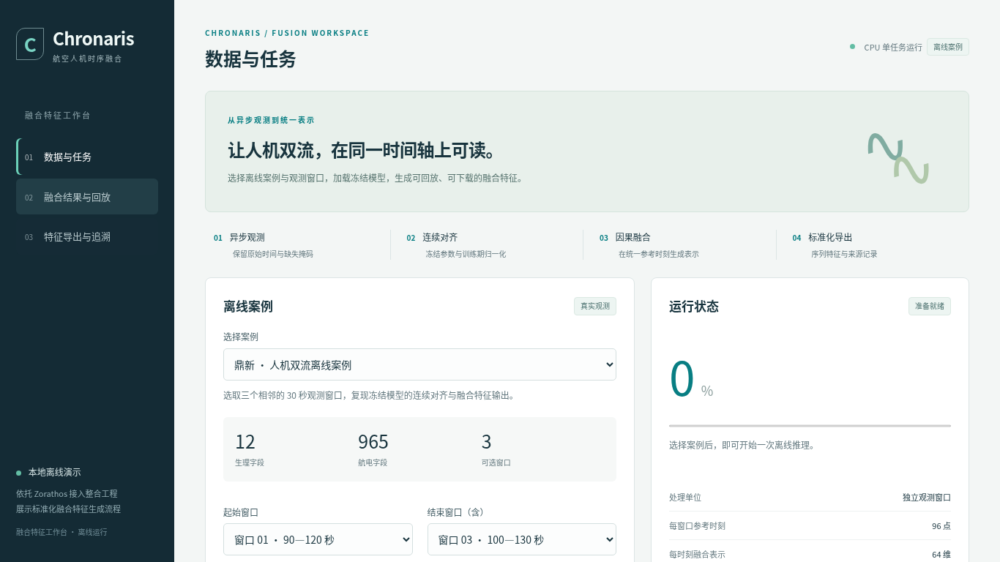

# 融合系统界面与管线独立验收

日期：2026-10-14（北京时间）。审查提交：`0936c2507a4cceb3405e1c6de8a6f5b09c4cd841`，分支：`feat/chapter6-demo`。结论：现有推理与导出核心可保留；按用户本轮提出的正式管线与论文展示要求，暂缓通过。

**修复进展：用户已授权并完成应用修复，结果见[修复验收](repair.md)。以下保留修复前的发现与证据。**

## 范围与依据

本轮检查关联开发聊天、相对 main 的实现变更、相关模型加载与标准表示合同、当前浏览器界面和测试。实际运行以单人、本机中央处理器、已准备观测和冻结权重为范围，不将多用户部署或整套训练平台重建列为当前要求。

关联聊天：`01a1348f-ff26-76e0-8d96-59a1305eb7da`，已通过 read_thread 读取。原任务明确要求先交付离线案例、结果、回放和下载；本轮用户提出实际可用管线，属于验收目标扩展。原交付符合小规模案例工作流的事实，与本轮要求存在差距的事实同时保留。

已完整加载论文工作区 `.agents/skills/thesis-writing/SKILL.md`，并读取关联研究写作规则和宿主机 DOCX 文档技能。论文文件只读核对保存版本，修改时间为 2026-10-13 22:48:06（北京时间）：正文第六章目前为章节骨架，涵盖数据访问、模型训练、批量推理与增量处理、下游接口、字段解释与规则复核；未把目录标题当作已经写成的功能论证。Word 本轮只核对内容，未做排版验收。

论文页面与截图采用用户此次明确指定的论文 SKILL。它要求对外使用“航空人机时序融合系统”“实测数据集”“依托平台”，比仓库内部数据称谓规则更严格。本报告为内部复核记录，保留原文与代码索引用于定位；截图记录当前缺陷，尚不作为论文可用图。

## 验收标准

以下标准把界面观感、业务可用性和实现正确性分别落实为可检查行为。

| 维度 | 通过标准 | 当前判断 |
| --- | --- | --- |
| 首屏任务操作 | 常见笔记本分辨率下，直接找到数据选择、时间范围、模型和主要执行按钮；每页一个明确主操作 | 待改，主按钮在首屏外 |
| 信息与文案 | 使用论文规定称谓；操作页面保留完成任务所必需的信息；工程参数与读取示例进入详情或帮助 | 待改，多处命名和辅助文字不符合要求 |
| 图表交互 | 时间、字段、单位、有效性可辨识；数值可查询；跨窗口颜色可比较；窄屏刻度可读 | 待改，热力图读数和窄屏刻度不足 |
| 数据与模型 | 从可用数据记录选择时段并形成样本；模型版本和训练来源可查，字段兼容性明确；新数据进入流程不依赖手工编辑目录 | 部分通过，模型与字段校验已有，入口仍依赖预制包 |
| 任务闭环 | 创建、校验、进度、失败原因、同参数重试、完成、回放与导出相互一致；刷新后可找回任务 | 部分通过，存在结果身份混用，失败任务缺少重试输入 |
| 管线衔接 | 数据访问、样本构建、模型选择、推理、标准输出及下游消费形成同一次可追溯任务；新增窗口处理有明确游标与去重语义 | 当前只覆盖中后段，增量接入待接通 |
| 组件与代码 | 相同展示与状态行为共用实现；接口、维数及状态定义有明确来源；不为抽象重复引入框架 | 已有基础复用，任务状态职责需要拆清 |
| 验证与展示一致性 | 测试覆盖真实输入、输出回读、任务切换、错误恢复；截图与实际功能及模型配置一致 | 基础测试通过，业务与交互回归待补 |

完整管线可以以已归档飞行记录作为真实输入，不要求为了界面外观重写采集系统或改为实时流。增量处理首先应落实新增窗口的发现、游标、重复处理控制和中断恢复；是否需要跨窗口潜态续算，应由方法合同决定，不能以逐窗口循环直接证明，也不把潜态续算作为未经确认的新算法要求。

## 必须处理

### 1. [P1] 页面及动态内容违反论文固定称谓

位置：`src/chronaris/serving/fusion_workbench/static/index.html:2–6,18`；`prepare.py:56–59`；`static/app.js:136`。

现象：页面标题、侧栏、页脚和导出区显示内部系统名、平台名和数据地名；数据页、回放页和环境标签持续强调“离线”“演示”“内部验证”。本轮浏览器读取的案例摘要与实际截图均能复现。只修改 HTML 会遗漏案例包和历史结果中的动态文案。

建议：建立一套面向读者的显示名称映射，覆盖页面、案例摘要、历史结果、下载入口和对外截图。系统展示为“航空人机时序融合系统”，来源展示为“实测数据集”，背景展示为“依托平台”。使用“数据记录”“处理任务”“结果回放”等职责名称。保持内部标识、冻结来源和完整性记录可追溯，历史记录不通过直接覆盖来改名。

不处理的影响：截图无法按当前论文写作规范交付；用户仍直接看到研究演示工具的身份。名称修订需要和下一项实际功能补齐同步进行。

### 2. [P1] 数据入口与任务链尚不足以交付可用管线

位置：`prepare.py:23,56`；`server.py:21–28,63–83`；`inference.py:32–50`；`static/app.js:146–148`。

现象：准备脚本固定提取模型内部验证列表的前三个窗口；服务只在启动时扫描案例目录。网页没有按数据记录或架次选择时间范围、构建样本或导入合规数据的入口，用户遇到新数据需要离开界面、手工准备包并重启。现有单任务请求只支持 1—8 个窗口，逐窗口生成后统一导出，未提供新增窗口发现、游标或恢复接口。

建议：复用 `access/loader.py` 的数据读取组织、既有样本构建和当前表示接口，补一个真实的数据选择与准备入口；已有归档记录或经过校验的数据导入均可作为最小实现。服务端按块处理完整选择范围，保留有界资源占用，把“每批 8 窗口”与“任务最多 8 窗口”分开。任务以同一个标识串联数据、样本、模型、推理和导出。新增窗口处理以可持久化游标推进。

模型方面，当前实际配置为 `semantic_event_enabled=false`，页面也如实显示未启用。工作台绑定自监督模型，尚无独立的模型版本选择和能力目录。完整方法案例应选择已经训练完成、字段兼容并通过验证的相应模型；优先复用既有训练记录作为模型来源，不要求为界面另建训练框架，也不通过推理时开启未训练模块来包装能力。

论文功能与当前入口的对应关系如下，用于安排接入顺序。

| 论文功能 | 当前工作台覆盖 | 最小衔接建议 |
| --- | --- | --- |
| 数据访问与样本构建 | 读取预制窗口包 | 可用记录列表、时间选择、字段及质量校验、样本准备 |
| 模型训练 | 加载既有自监督冻结模型 | 展示真实训练来源、模型版本和能力；与现有训练产物连接 |
| 批量推理、增量处理与回放 | 有界窗口推理与结果切换 | 长任务分块、持久化游标、恢复；回放绑定真实时间 |
| 标准化特征与下游接口 | 标准输出和回读已贯通 | 选定一个现有消费者完成实际读取或调用，显示交付状态 |
| 字段解释与规则复核 | 本工作台没有入口 | 接入既有 `llm_preprocessing` 的字段解释与复核记录，并提供人工复核状态 |

既有 `serving/runtime_inference.py:340` 中的 incremental 模式也是将批大小设为 1，不能据函数名认定已经具有跨请求持久增量能力。新增接口需要核对当前模型合同，避免直接搬用旧模型服务。

不处理的影响：系统仍依赖开发者预制案例，无法让使用者自行完成新数据的处理。删除提示文字无法弥补这项功能差距。

### 3. [P1] 打开历史后，“查看本次结果”指向旧任务

位置：`static/app.js:62,85,144`。

复现：完成窗口 03 的新任务，打开较早的三窗口历史，返回“数据与任务”，点击“查看本次结果”。状态区域仍指向新完成任务，按钮却打开旧任务的三窗口结果。

原因：提交任务和打开历史都写入全局 `currentRun`；“查看本次结果”用这个可被历史浏览覆盖的变量定位。实测新任务为 `662e0cfbddbc46fea0f3939dd277ca9a`，点击按钮实际打开 `3159432cd3674a0fa88a331fd09f2cd9`。见 `checks.json`。

建议：明确区分当前处理任务与当前浏览结果，进度和本次结果按钮绑定前者，回放与下载绑定后者；增加“新任务完成→打开旧历史→查看本次结果”的浏览器回归。

不处理的影响：用户可能在新任务完成后读取或导出另一批窗口的结果，界面身份与结果身份不一致。

## 应当处理

### 4. [P2] 首屏说明过多，主操作被挤到下方

位置：`static/index.html:6–10`；`static/style.css:1`。

实测：1440×900 和 1366×768 下，初始“生成融合特征”按钮上缘均约为 919 像素；笔记本首屏无法看到。数据页有 15 个字号不超过 12 像素的可见说明或标签节点。宣传横幅、静态四步流程、案例说明、冻结模型说明及右侧固定参数重复解释系统能力。

建议：删除操作页的宣传横幅，将静态流程改成与任务进度绑定的紧凑状态条。首屏只保留数据记录、时间范围、模型、执行按钮与必要校验；把格式、维数、散列、实现方式和读取代码收进详情或接口文档。保留坐标单位、错误原因等决策必需信息，避免把所有小字一律删除。

不处理的影响：用户先读介绍再寻找操作，界面更接近说明页而非日常处理工作台。

下图记录 1366×768 的真实首屏，支撑主操作层级问题；图中文字为待修订现状。



### 5. [P2] 热力图颜色尺度不固定，数值查看不足

位置：`static/app.js:99–104,118–135`；`static/index.html:12`。

现象：热力图逐窗口计算最大绝对值作为色阶范围，但图例只显示正负；三个真实窗口范围分别约为 ±2.0625、±2.1894、±1.9262，切换时相同颜色对应不同数值。纵轴缺少特征维度索引，滑块只显示第 1 维，导出预览固定取每窗口第一个时刻的前六维，无法检查任意热力图单元。390 像素窄屏下，曲线刻度实际高度约 7 像素。

建议：同一任务使用明确的共同数值色阶，或在切换时显示实际色阶上下限；标示维度索引，提供悬停或键盘定位的时刻、维度、数值和有效性读数，联动双流时间游标。窄屏保留足够刻度字号，通过减少默认显示字段和展开查看控制高度。

论文图另按 SKILL 的数值标注规则导出选定区间或少量维度，保留完整数据来源；不要把 96×64 个数值强行塞入默认工作界面。原始观测和表示仍需明确区分，不能以特征值直接命名业务状态。

不处理的影响：图形可以观看，但难以判断变化大小或定位对应特征，截图也难以承担可读的结果展示。

以下截图记录桌面结果页与窄屏结果页，便于复核颜色图例、维度刻度和字体。

- [桌面结果](desktop-results.png)
- [窄屏结果](mobile-results.png)
- [导出页面](desktop-export.png)

### 6. [P2] 失败任务缺少原始选择，重试无法沿用参数

位置：`server.py:78–83,90–99`；`static/app.js:71–77`。

现象：提交时 job 文件只保存案例、状态和窗口总数，没有保存起止索引或完整任务请求。成功任务另有 result 中的 selected_indices，模型加载或输入校验失败时没有结果文件。因而选择两个窗口后失败、刷新页面，仅能看到“0/2”和原因，无法从记录还原选择的是哪两个窗口；界面也只提供“查看原因”。

建议：创建任务时持久化经过校验的选择和模型版本；失败记录提供“按原参数重试”，生成新任务并关联原任务。历史表显示时间范围，避免同案例多次运行只能靠时间和窗口数量区分。

不处理的影响：故障恢复依赖用户记忆，与实际任务管理及可追溯性要求不符。

### 7. [P2] 已知无效的窗口范围仍可提交

位置：`static/app.js:33–36,57–63`。

复现：选择起始窗口 03、结束窗口 01，页面已经显示范围无效，但“生成融合特征”仍可点击；点击后接口再返回“每次请选择 1—8 个连续窗口”。`extra-checks.json` 记录了按钮启用状态和实际错误。后端校验有效，没有错误地执行推理。

建议：约束结束选择或在范围无效时禁用提交，把错误留在字段附近；运行状态和输入有效性共同决定按钮状态，同时保留后端校验。

不处理的影响：页面明知输入不合法仍让用户发起无效请求，增加操作成本。

## 组件组织建议

现有 `api`、`cell`、`traces`、`renderWindow` 已形成共享基础，不建议以“组件化”为由整体改写框架。下一步围绕实际重复行为整理任务状态、状态标记、字段曲线、时间游标和来源详情；将固定 96 时刻、64 维的展示配置与既有表示合同对齐，避免每个页面分别维护常量。

HTML 18 行、CSS 1 行将整页压缩，不利于逐项审阅和维护。整理为正常缩进的源文件即可；无需为了行数机械拆出大量只有一个调用的组件。性能方面先保留单任务和资源上界，完整时段用分块处理，暂不引入分布式队列。

建议页面按“数据与任务、模型与字段、结果分析、特征交付”组织；模型训练来源与字段复核可先作为详情页。页面主路径是：选数据和时段→确认字段与模型→执行任务→分析与回放→交付特征。所有状态来自实际接口。

## 实际验证

本轮验证结果支持保留现有数值处理和标准交付核心，同时复现了上述界面缺陷。

| 检查 | 本轮结果 |
| --- | --- |
| 新增服务与既有表示合同、导出测试 | 26 passed，2.01 秒 |
| 真实 CPU 推理 | 窗口 03 完成，任务记录耗时约 0.572 秒；仅单次工程样本 |
| 真实 ZIP 下载与标准读取 | 输出形状 1×96×64，成员及读取通过 |
| CSV 逐值对照 | 96 行，与归档中的序列表示逐值相同 |
| 桌面视觉检查 | 1440×900 的数据、结果、导出页；1366×768 的首屏 |
| 窄屏视觉检查 | 390×844，无横向溢出，曲线刻度约 7 像素 |
| 页面脚本异常 | 本轮正常浏览和推理路径未观察到 pageerror |
| 本次结果身份 | 可重复打开旧任务，失败 |
| 无效表单范围 | 前端允许提交，后端正确拒绝 |

测试命令：

```bash
CUDA_VISIBLE_DEVICES='' OMP_NUM_THREADS=1 OPENBLAS_NUM_THREADS=1 MKL_NUM_THREADS=1 \
PYTHONNOUSERSITE=1 PYTHONDONTWRITEBYTECODE=1 PYTHONPATH=src \
/home/wangminan/env/anaconda3/envs/chronaris/bin/python -m pytest \
  tests/runtime/test_fusion_workbench.py \
  tests/representation/test_contracts.py tests/representation/test_oof_export.py -q
```

浏览器使用工作区已有 Playwright 和 Chromium。截图来自实际 HTTP 服务，未使用静态 preview.html 替代运行界面。证据数值见 `checks.json`、`extra-checks.json`、`download-check.json`；任务记录与下载副本保存在本工作区忽略目录 `artifacts/fusion-workbench/review-20261014/`。

下一轮必须增加任务切换、失败重试、无效选择、空数据、服务断连恢复、完整时段分块、增量去重和刷新恢复测试；图表补数值色阶及小屏可读性验收。训练运行管理可读取现有任务记录，本轮不授权新训练。

## 收口意见

先处理 1—3 项，再完成 4—7 项和新的业务闭环验收。优先保留模型加载、字段校验、标准表示写出与回读、下载白名单和原子任务记录写入；按需补接已有模块。所有建议均未实施，源码、界面资源、测试代码、冻结模型和论文文件保持原样。

本轮只新增复核记录及截图、更新复核索引；未提交、推送或合并。未检查生产多用户部署、完整数据库调用、长时间运行或新增训练；Word 只做章节内容核对。当前页面不能直接作为“完整管线已验收”的证据。
